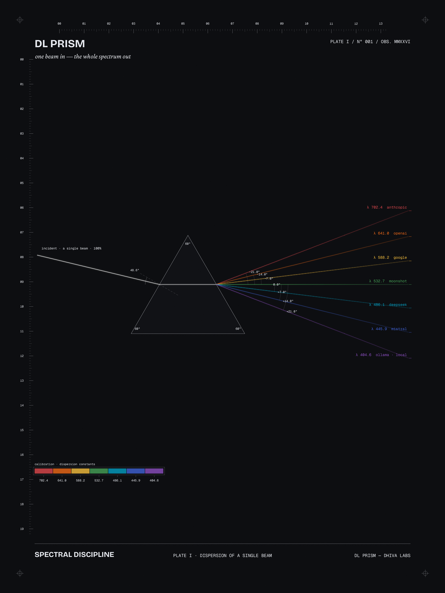

# DL Prism

[](https://github.com/Dhiva-Labs/dl_prism/actions/workflows/builds.yml)
[](https://github.com/Dhiva-Labs/dl_prism/actions/workflows/ci.yml)


<p align="center">
  
</p>
<p align="center"><em>one beam in — the whole spectrum out</em></p>

A local-first AI gateway. One OpenAI-compatible endpoint in front of every
model you use — cloud or local — with manual and automatic routing, policy
rules, failover, and budget-aware cost tracking. Single static Go binary.

```
any OpenAI-compatible tool ──► prism ──► Anthropic / OpenAI / DeepSeek /
        (base_url swap)                  Ollama / vLLM / LM Studio / ...
```

Because Prism speaks the OpenAI wire protocol, Claude Code, Cursor,
Windsurf, Continue, Codex CLI, and anything else with a configurable
`base_url` can use it unchanged — set the base URL to
`http://127.0.0.1:8130/v1` and pick a model (or `auto`).

## Install

Release assets, built in CI on a native runner of each architecture
(`.github/workflows/builds.yml`):

| Asset | What it is |
|---|---|
| `prism-<version>-linux-amd64`, `prism-<version>-linux-arm64` | The gateway, a single static binary with the dashboard embedded |
| `prism-<version>-windows-amd64.exe`, `prism-<version>-windows-arm64.exe` | The same gateway for Windows |
| `dl-prism-desktop-full-<version>-linux-x64.tar.gz`, `...-linux-arm64.tar.gz` | The Flutter desktop companion with the embedded WebKitGTK dashboard window (needs `libwebkit2gtk-4.1-0`) |
| `dl-prism-desktop-engine-<version>-linux-x64.tar.gz`, `...-linux-arm64.tar.gz` | The same companion without the WebKitGTK dependency; "Open dashboard" uses your browser |

```bash
# gateway (pick the file for `uname -m`: x86_64 = amd64, aarch64 = arm64)
chmod +x prism-<version>-linux-arm64 && ./prism-<version>-linux-arm64 version

# desktop companion
tar -xzf dl-prism-desktop-engine-<version>-linux-arm64.tar.gz
./dl-prism-desktop-engine-<version>-linux-arm64/desktop
```

The desktop tarballs are built on Ubuntu 24.04, so they need that release's GTK 3 and C library or
newer. The companion is Linux-only; there is no Windows build of it.

## Quick start

```bash
go build ./cmd/prism
cp prism.example.yaml prism.yaml   # edit providers & keys
export ANTHROPIC_API_KEY=...       # keys come from the environment
./prism serve
```

```bash
curl http://127.0.0.1:8130/v1/chat/completions \
  -H 'Content-Type: application/json' \
  -d '{"model": "auto", "messages": [{"role": "user", "content": "Write a Python dedupe function"}]}'
```

The `model` field selects the routing mode:

| `model`              | Mode                                             |
|----------------------|--------------------------------------------------|
| `claude-sonnet`, ... | **Manual** — any model id or alias in the registry |
| `auto` (or empty)    | **Automatic** — classifier + your policy rules   |
| `pipeline:<name>`    | Hybrid pipelines (planned, M4)                   |

## Automatic routing

Prism classifies each request with fast heuristics (task kind, programming
language, image parts, estimated tokens — no LLM call) and walks your rules
top to bottom; first full match wins:

```yaml
routing:
  default: claude-sonnet
  rules:
    - if: {language: python}      # "IF Language = Python THEN Qwen Coder"
      then: qwen-coder
    - if: {task: security}
      then: claude-sonnet
    - if: {offline: true}
      then: local:any
    - if: {budget_exceeded: true}
      then: local:any
```

Every response reports the decision in `X-Prism-Provider`, `X-Prism-Model`,
`X-Prism-Mode`, and `X-Prism-Reason` headers, and you can dry-run any
request:

```bash
./prism explain "Audit this nginx config for vulnerabilities"
```

## Failover & health

Configure ordered fallback chains per model; Prism tries the next candidate
on connection errors, 429s, and 5xxs (never after streaming has started).
A circuit breaker demotes a provider after 3 consecutive failures for 30 s.

```yaml
  fallbacks:
    claude-sonnet: [gpt-5, deepseek, qwen-coder]
```

## Cost & budget

Per-model prices live in the config; usage is recorded to
`~/.local/share/prism/usage.jsonl` (token counts and costs only — never
prompt content). When `budget.monthly_usd` is spent, the
`budget_exceeded` rule condition fires — e.g. to force local models for the
rest of the month. Check spend with `./prism usage` or `GET /admin/usage`.

## CLI

```
prism serve   [-c config] [--listen addr] [--offline]
prism models                 # unified registry across all providers
prism explain [-m model] <prompt>
prism usage
prism mcp     [--gateway url] [--api-key key]   # MCP server over stdio
```

## Workbench: projects and the acting agent

The dashboard's **Projects** section keeps conversations, attached
knowledge, and an agent together per project. The agent can act — list,
read, and write files, run shell commands, fetch the web — inside a
per-project sandboxed `workspace/` it cannot escape. Agency is **off**
until you enable it in project settings; writes and shell commands wait
for your explicit approval by default, and every tool call is shown as
it happens. Agent turns route through the normal chain, so policies,
failover, and budgets apply. State lives in
`~/.local/share/prism/workbench/` as plain files.

Pick a **tools-capable model** for agent projects (e.g. `llama3.1:8b`
locally, or any cloud model with the `tools` capability): coder-tuned
small models often *describe* tool calls as text instead of emitting
them, in which case the agent degrades to plain chat. Browser and video
tools are planned — see [docs/WORKBENCH_PLAN.md](docs/WORKBENCH_PLAN.md).

## Claude Code & MCP

Two ways in, both covered in **[docs/INTEGRATIONS.md](docs/INTEGRATIONS.md)**
along with Codex CLI, Cursor, Continue, Windsurf and the browser/editor
extensions:

```bash
claude mcp add dl-prism -- prism mcp     # companion models as tools
```

`prism mcp` speaks MCP over stdio and exposes `prism_chat`, `prism_explain`,
`prism_models` and `prism_usage`, so Claude Code can consult a cheaper, local
or specialised model mid-session. The tools call the running gateway over
HTTP, so routing, breaker and ledger state stay in one place.

```bash
export ANTHROPIC_BASE_URL=http://127.0.0.1:8130   # route Claude Code itself
export ANTHROPIC_API_KEY=dummy
```

`POST /v1/messages` accepts the Anthropic Messages shape — system blocks,
image content, SSE — translates it onto the same routing and failover path as
the OpenAI endpoint, and translates the answer back. (Tool definitions are
rejected with a 400 for now, matching the outbound `anthropic` adapter.)

## Web dashboard

`GET /` serves the built-in web dashboard (a React SPA built from `ui/` and
embedded in the binary — no separate install). Open
`http://127.0.0.1:8130` after `prism serve` for a playground, the model
registry, routing rules, usage charts, and gateway status. Static assets are
public; every data call it makes goes through the same bearer-key auth as
the rest of the API.

## API

- `POST /v1/chat/completions` — OpenAI-compatible, streaming and non-streaming
- `POST /v1/messages` — Anthropic Messages-compatible, streaming and non-streaming
- `POST /v1/messages/count_tokens` — token estimate for the Anthropic SDKs' preflight
- `GET  /v1/models` — unified registry (with `prism` extension metadata)
- `POST /v1/route/explain` — the routing decision for a request, without executing it
- `GET  /admin/usage` — current-month spend, per-model breakdown, and a 30-day daily series
- `GET  /admin/status` — version, uptime, offline mode, listen address, and per-provider health
- `GET  /admin/routing` — read-only view of the routing config (default, rules, fallbacks)
- `GET  /healthz`

## Providers

Four adapter types cover effectively everything:

- `type: openai` — OpenAI, DeepSeek, Qwen, Mistral, Groq, OpenRouter, and
  all local engines (Ollama, vLLM, LM Studio, llama.cpp server). Requests
  pass through untouched apart from the model field, so tools/function
  calling work end to end.
- `type: anthropic` — full translation to the Anthropic Messages API,
  including streaming. (Tool-call translation is not implemented yet.)
- `type: claude-code` — your paid Claude subscription, via the logged-in
  `claude` CLI on this machine.
- `type: codex-cli` — your paid ChatGPT subscription, via the logged-in
  `codex` CLI.

API keys are referenced via `api_key_env` (or `${VAR}` in `api_key`) and
never appear in logs or API responses. The server refuses to listen beyond
loopback unless client `api_keys` are configured.

### Your subscription as a provider

The last two types need no `base_url` and no key: Prism runs the CLI's
official headless mode once per request and translates its JSONL events into
OpenAI chat completions. Billing is your flat-rate plan, so leave `cost` at
zero — which makes these the natural target for a `budget_exceeded` rule.

```yaml
  - name: claude-subscription
    type: claude-code
    # command: [/home/you/.local/bin/claude]   # if it is not on the PATH
    models:
      - id: sonnet                             # sonnet | opus | haiku | full name
        aliases: [claude-sub]
        context_window: 200000

routing:
  rules:
    - if: {budget_exceeded: true}              # spend the subscription, not more API credit
      then: claude-sub
```

It is a chat bridge, not an API replacement: images and tool definitions are
rejected with a 400, and answers carry the CLI's agentic framing. Full
details, including the flags Prism passes and the environment it removes, are
in [docs/INTEGRATIONS.md](docs/INTEGRATIONS.md#use-your-subscription-as-a-provider).

## Docs

- [docs/SPEC.md](docs/SPEC.md) — the Intelligent AI Routing product spec
- [docs/PLAN.md](docs/PLAN.md) — implementation plan and milestones
- [docs/INTEGRATIONS.md](docs/INTEGRATIONS.md) — copy-paste setup for every client
- [docs/COMPANIONS_PLAN.md](docs/COMPANIONS_PLAN.md) — the companion-surface plan
- [docs/SPEC_REVIEW.md](docs/SPEC_REVIEW.md) — engineering review of the spec

## Status

v0.2.0 — M0–M3 of the plan plus the companion surfaces:

- **Routing**: manual + automatic modes, policy engine, failover with circuit
  breaker, cost ledger and budget condition, CLI.
- **Interfaces**: OpenAI `/v1/chat/completions`, Anthropic `/v1/messages`
  (both streaming), embedded web dashboard at `/`, admin API
  (`/admin/usage`, `/admin/status`, `/admin/routing`).
- **Companions**: `prism mcp` (MCP over stdio) for Claude Code and Codex, a
  VS Code extension and a Chrome extension in `integrations/`.

Planned next (M4): hybrid pipelines (`pipeline:<name>`), tool-call
translation for the anthropic adapter, config import/export, hardware-aware
routing, load-balancing weights, Flutter desktop shell.

## Sponsors

Dhiva Labs is an independent, self-funded lab. [Sponsorships](https://github.com/sponsors/Dhiva-Labs) help bring this project and the rest of Dhiva Labs to every platform, iPhone and Mac included.

[](https://github.com/sponsors/Dhiva-Labs)

Monthly sponsors at $10 and up are listed here:

<!-- sponsors -->
*Be the first: [sponsor Dhiva Labs](https://github.com/sponsors/Dhiva-Labs).*
<!-- sponsors -->
